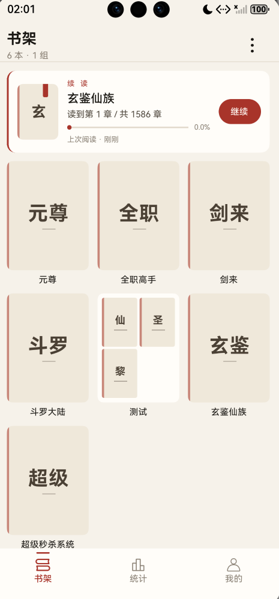
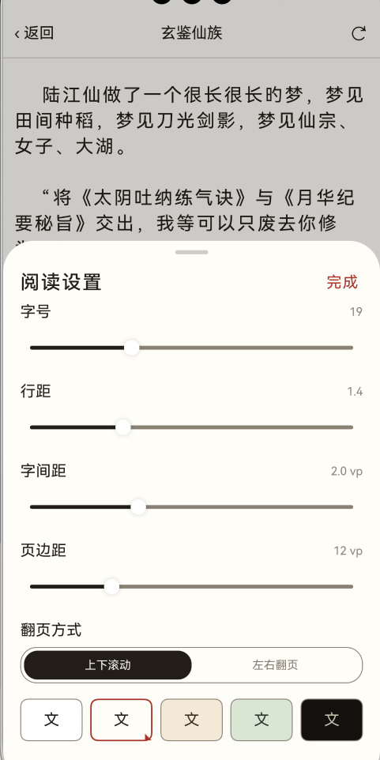

# 静读 NovelReader

**鸿蒙原生（HarmonyOS NEXT / ArkTS）的纯本地 TXT 小说阅读器：导入手机里存的 TXT，自动识别编码、自动分章，然后离线读。**

不需要账号、不联网、没有广告，书与进度全部留在应用沙箱里，适合在鸿蒙设备上读自己攒下的 TXT 长篇。

|  |  |  |  |
| ------------------------------------ | -------------------------------------- | ---------------------------------------- | ------------------------------------ |


---

## 主要功能

| 模块 | 功能 |
|---|---|
| **导入** | 经系统文件选择器导入 TXT · SHA-256 内容指纹去重 · UTF-8 / GBK / GB18030 / UTF-16 自动探测 · 十余条分章规则 · 两阶段导入（编码与分章预览 → 确认入库）· 分章可疑时主动提示换编码 |
| **书架** | 网格（3 列）/ 列表双视图 · 继续阅读卡片 · 分组 · 三种排序（最近阅读 / 导入时间 / 书名）· 书名搜索 · 骨架屏 / 空状态 / 错误重试 |
| **阅读** | 三种翻页：上下滚动 / 左右翻页 / 平移翻页 · 单击三分区（左上一页、右下一页、中间呼出菜单）· 章末自动衔接下一章 · 沉浸式全屏 · 常驻底栏显示章节名与页码百分比 |
| **排版** | 字号 · 行距 · 字间距 · 页边距 · 五套正文主题（日光 / 暖白 / 羊皮纸 / 护眼 / 夜间）· 亮度 · 屏幕常亮 · 隐藏状态栏 · 音量键翻页，全部设置持久化 |
| **标注** | 长按选中文字 → 书签 / 划线 / 笔记（排在系统"复制"之前）· 划线以底纹画在正文上 · 目录页按类型筛选、跳转、删除 |
| **目录与搜索** | 独立目录页（整屏）· 当前章高亮并自动滚到位 · 全书正文搜索，结果带上下文片段，点击直接跳转 |
| **进度** | 「章节序号 + 章内偏移 + 百分比」三重记录，绝不存页码：换字号、换翻页方式、重启、切后台后都回到同一句话；10 秒节流落库 |
| **统计** | 今日 / 累计时长 · 近 7 天柱状图 · 90 天热力图 · 连续与累计天数 · 各书时长 · 5 分钟无操作自动暂停计时 |
| **数据** | 导出 / 导入 JSON 备份（合并式恢复，不覆盖）· 清除分页缓存 · 清空所有数据（二次确认）· 应用级外观（跟随系统 / 日间 / 夜间） |

## 安装方法

**环境**

| 项 | 版本 |
|---|---|
| IDE | DevEco Studio（与 HarmonyOS SDK 6.0.2 配套的版本） |
| SDK | `compatibleSdkVersion` 6.0.1(21) / `targetSdkVersion` 6.0.2(22)，工程 `modelVersion` 6.0.2 |
| 设备 | 鸿蒙真机或模拟器（`deviceTypes` 仅声明 `phone`） |

**从源码运行**

1. 用 DevEco Studio 打开工程根目录（`build-profile.json5` 所在目录）。
2. 同步依赖（仅测试框架用得到）：

   ```bash
   ohpm install
   ```

3. `File → Project Structure → Signing Configs`，勾选 **Automatically generate signature**（工程内 `signingConfigs` 为空，签名信息属个人环境，不入库）。
4. 连接真机或启动模拟器，选 `entry` 模块，点 **Run**。

**构建 HAP**：`Build → Build Hap(s)/APP(s)`，产物在 `entry/build/default/outputs/default/`（`build/` 已列入 `.gitignore`）。

## 使用方法

**1. 导入一本书**

1. 打开应用进入「书架」，点标题行右侧的 **+**。
2. 在系统文件选择器里选一个 `.txt` 文件。
3. 进入「导入确认」页：确认书名、编码、分章数量；分章结果异常时可切换编码重新解析（不必重新选文件）。
4. 点确认入库，书出现在书架上（同一文件重复导入会被指纹去重挡掉）。

**2. 阅读**

1. 点封面进入阅读页。
2. 分页模式下：点屏幕左侧 1/3 上一页、右侧 1/3 下一页、**中间 1/3 呼出/隐藏菜单**；左右滑动也能翻页。滚动模式下上下滑动即滚动正文，点整屏切换菜单。
3. 菜单底栏：**设置**（字号 / 行距 / 字间距 / 页边距 / 翻页方式 / 主题 / 亮度 / 常亮 / 隐藏状态栏 / 音量键翻页）、进度条拖拽跳转、上一章 / 下一章。
4. 顶栏左侧返回、右侧「目录」进入目录页。

**3. 加书签、划线、笔记**

1. 在正文里**长按选中一段文字**，弹出系统选择菜单。
2. 菜单里第一项是本应用追加的：**书签 / 划线 / 笔记**（原有"复制 / 全选 / 搜索"保留）。
3. 书签可填备注、笔记必须填内容；划线点了就保存。
4. 目录页的「书签」Tab 可按 **全部 / 书签 / 划线 / 笔记** 筛选，点一条跳转，也可删除。

**4. 搜索书内内容**

阅读页 → 顶栏「目录」→「搜索」Tab → 输入关键词 → 结果为「章节名 + 上下文片段（命中词加【】）」→ 点击跳转。

**5. 分组与书籍管理**

- 书架页「新建分组」；长按分组：**打开分组 / 加入书籍 / 重命名 / 解散分组**。
- 长按书籍：**开始阅读 / 书籍详情 / 换编码（正文乱码时用）/ 从书架移除**。

> 「换编码」会重新分章，已确认时会提示"将删除 N 条书签/笔记"并要求二次确认。

**6. 查看统计与备份**

- 底部导航「统计」：今日时长、近 7 天柱状图、90 天热力图、各书时长。
- 底部导航「我的」：外观切换、阅读主题、**导出备份 / 导入恢复**、清除分页缓存、清空所有数据、关于。

## 输入输出示例

### 示例一：导入 TXT → 自动分章

**输入**（`长夜行.txt`，UTF-8 或 GBK 均可）：

```text
序章 雨夜

城里的雨下了三天，屋檐连成了水线。

第一章 旧书店

他推门进去的时候，门口的铃铛响了一声。

第二章 无字书

老人从柜台底下抽出一本没有封面的册子。
```

**输出**：编码探测结果 + 入库后的目录（章序号 0-based；正文按**原文件字节偏移**随机读取，不整本载入内存）。

| chapter_index | title | 命中的规则 |
|---|---|---|
| 0 | 序章 雨夜 | 「序章 / 楔子 / 番外」类 |
| 1 | 第一章 旧书店 | 「第 N 章」类 |
| 2 | 第二章 无字书 | 「第 N 章」类 |

标题单独存表供目录展示；每章的 `start_offset` 指向**标题行之后的正文首字节**，所以正文里不会重复出现标题。

### 示例二：「我的 → 导出备份」产出的 JSON

**输出**（保存为 `jingdu-backup-20261024-1530.json`，字段即导出结构）：

```json
{
  "version": 1,
  "exportedAt": 1762241400000,
  "books": [
    {
      "uuid": "9f1c2e7a4b6d8c05",
      "title": "长夜行",
      "author": "",
      "lastChapterIndex": 1,
      "lastOffset": 840,
      "annotations": [
        {
          "chapterIndex": 1,
          "type": 1,
          "startOffset": 412,
          "endOffset": 486,
          "selectedText": "他推门进去的时候，门口的铃铛响了一声。",
          "noteContent": "开场的第一个转折",
          "color": "",
          "createdAt": 1762239600000
        },
        {
          "chapterIndex": 1,
          "type": 2,
          "startOffset": 210,
          "endOffset": 257,
          "selectedText": "屋檐连成了水线",
          "noteContent": "",
          "color": "#FFF2A8",
          "createdAt": 1762239700000
        },
        {
          "chapterIndex": 1,
          "type": 3,
          "startOffset": 210,
          "endOffset": 257,
          "selectedText": "屋檐连成了水线",
          "noteContent": "这里的比喻很好，冷雨写出了温度",
          "color": "",
          "createdAt": 1762239800000
        }
      ]
    }
  ]
}
```

字段含义：`type` 为 `1` 书签 / `2` 划线 / `3` 笔记；`lastChapterIndex` 与 `lastOffset` 就是阅读进度（`offset` 是**章内 UTF-16 下标**，不是页码）。备份只含用户创造的数据（进度 + 标注），不含 TXT 书源与分页缓存。

### 示例三：「我的 → 导入恢复」的合并结果

**输入**：上面那份 JSON，而当前书架里这本书已经有进度「第 2 章、偏移 1200」和 1 条内容相同的划线。

**输出**（合并式恢复，不是整库覆盖）：

| 数据 | 处理结果 |
|---|---|
| 阅读进度 | 取更靠后的一个 → 保持「偏移 1200」（备份里的 840 更靠前，丢弃） |
| 内容与位置相同的划线 | 判为重复 → 跳过，不产生第二条 |
| 书签与笔记 | 新增 2 条（各 1 条） |
| 备份里有、但书架上已删除的书 | 跳过（书源 TXT 不在了，标注没有锚点） |

导入完成后提示「已恢复 N 条标注 / 更新 M 本书」。

## 技术要点

- **大文件按字节偏移寻址**：导入以 1 MiB 分块流式解码，分章只记每章字节区间；阅读按偏移随机读单章（单章上限 2 MiB + LRU 缓存），内存占用与书的大小无关。
- **分页与渲染同源**：字体解析收敛到唯一入口，测量宽度与渲染宽度取同一个值；分页结果按排版指纹 `layoutKey`（宽/高/字号/行距/字距/边距/字体/算法版本号）缓存。
- **进度与排版解耦**：书签、划线、笔记、进度共用「章内 UTF-16 偏移」同一套坐标，换字号或换翻页方式后位置依然准确。
- **存储**：RelationalStore（SQLite，6 张表）+ Preferences + 应用沙箱文件；表结构、索引与迁移策略见设计文档。

## 文档与许可证

- [项目说明介绍](docs/项目说明介绍.md) · [设计文档](docs/小说阅读器设计文档.md)（含分层架构、表结构与 70+ 条 ArkTS/ArkUI 踩坑记录）
- 代码以 [MIT](LICENSE) 发布；界面图标（`entry/src/main/resources/base/media/*.svg`）来自 iconfont，二次分发前请自行确认其授权条款。
